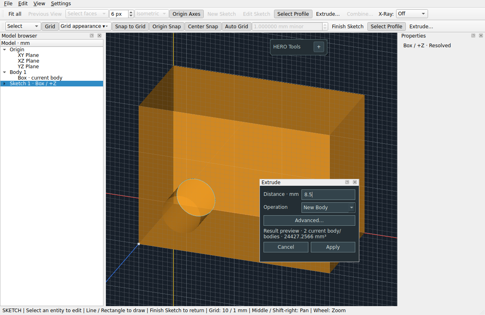

# PR #25 — quick extrusion and origin-plane sketch access

## Everyday workflow

1. Draw a closed profile, or select its sketch in the browser.
2. Choose **Select Profile** and click inside the intended material region.
3. Choose **Extrude** in the toolbar, context menu or HERO Tools island.
4. Type a signed distance in millimetres and press **Enter**.

The screenshot below records PR #25’s earlier appearance. Current operation
colors/placement are described in [OPERATION_APPEARANCE.md](OPERATION_APPEARANCE.md).

The compact nonmodal panel opens beneath the HERO Tools island with a 3 logical
pixel gap, using above-island/clamped placement when screen space is limited.
Distance is focused and selected so typing replaces the default. It can be moved by its native title bar. Operation
and, when needed, target body remain visible. Changing the operation never chooses
a different target. Its orange/cyan-gray palette distinguishes operations from
the unchanged dark tool island.

**Enter / Apply** validates the raw text, validates/previews the candidate if
needed, then commits once and closes. **Escape / Cancel / close** discards the
candidate/preview and returns focus to the viewport without a history entry.
Invalid, incomplete, zero, nonfinite or out-of-range values remain editable with
inline feedback and keyboard focus. No previous distance is silently substituted.
Signed decimals and scientific notation use a decimal point. The existing
±0.000001 to ±100000 mm range applies; entered finite float precision is retained
in the feature rather than rounded through the hidden spin box.

Valid edits update the existing preview after **180 ms** without permanent
history. Intermediate invalid text never evaluates a candidate. A stale preview
is cleared, and the normal body display is restored once, rather than remeshed
on every invalid keystroke. Manual Preview and Enter cancel any pending timer.
Preview remains synchronous OCCT evaluation; very complex models may still pause
when the debounced evaluation actually runs.

**Advanced** exposes the existing extent/Through All and direction controls and a
manual Preview button. Through All remains Cut-only, with explicit direction;
the irrelevant distance field disables. Feedback has bounded height and a full
text tooltip. Form growth uses the available screen space or scrolls without
moving the panel.

This is a presentation mode of the same OperationPanel, using the same operation,
target, definition, candidate Document, preview actor and transaction methods.
There is no second extrusion implementation. **Edit Operation** and Combine
share the floating operation presentation; feature Properties retains its
established editor.

## Context-aware defaults (Work Order #030)

New extrusions default to **Join** when the source sketch has a resolved face
attachment whose explicit owner is an eligible current target body. That owner
is preselected even when other bodies are available. Origin-plane sketches and
unavailable/consumed attachment owners default to **New Body**; no target is
inferred from proximity, history order or successor bodies. The existing hidden
base-box target exclusion still applies. An unresolved attachment cannot suggest
Join. Defaults are initialized once per new extrusion, are not remembered as a
preference, and never override manual operation changes or stored feature edits.
Attachment does not guarantee contact: the existing preview must validate the
actual joined result before Apply. Invalid Join keeps its diagnostic and can be
changed manually; a negative distance never implicitly changes the operation to
Cut. Missing targets and invalid Boolean results remain
validation failures. Undo/Redo and save/reopen retain normal feature semantics.

## Confirmed sketch interaction/display causes

Origin coordinates were correct: XY/XZ/YZ really belong at world zero. No sketch
or plane is moved in this PR.

The model-view profile picker explicitly rejected points behind a visible solid.
This was correct ordinary occlusion, but there was no explicit selected-sketch
inspection scope outside editing. A finished origin sketch could therefore be
unreachable behind the base box unless the user hid it or reentered editing.
Active entity/profile input was already routed before solid picking; that priority
is retained rather than inventing a different picking system.

Active curves also shared the model depth/compositing pass. With an obstructing
body (especially Orange X-Ray at 85%), their original cyan could be blended away.
Rendered tests reproduce the contrast difference by comparing that pass with the
new foreground pass. The XZ front-facing case was already readable; XY/YZ tests
show the improvement for obstructed views.

## Display and selection changes

A separate foreground renderer shares the **same camera** as the model. It draws
only active sketch curves/preview/highlight/snap/origin, or the explicitly scoped
sketch's curves/profile inspection. It preserves the model color image and has
its own depth pass. Ordinary solids, other sketches and world axes retain their
existing renderer/depth behavior. There is no global depth-test override or large
geometric offset. Guides remain in the existing guide pass.

The foreground curve copy uses the existing double-precision sampled paths and
quality-band cache, with the existing cyan and **one-pixel width**. It is
unpickable and excluded from Fit bounds. Existing analytic frames, geometry,
wide screen hitbox, snapping, selection colors and camera/navigation paths remain.
Bodies retain their existing visibility and opacity preferences (35% context or
the explicit X-Ray mode); they do not disappear during editing.

For a hidden finished profile, select its sketch (or entity/source extrusion) in
the browser, then **Select Profile**. Only that sketch is inspected through
bodies, with foreground outlines and click-inside material selection. While this
mode is active, changing the browser sketch changes the explicit scope and clears
the old region selection. It never selects a region automatically. Status text
and the command tooltip explain the scope.

With no selected sketch scope, profile picking retains visible-region occlusion
and rejects coincident ambiguous profiles. Holes, overlapping loops and invalid
regions keep their existing classifier behavior. Toggle off Select Profile to
restore ordinary face/edge selection. Leaving editing/inspection restores normal
sketch depth rendering. Deleting the scoped sketch clears that mode rather than
silently inspecting a different sketch. These are transient view/input states,
not document properties or construction planes.

## Desktop checks

1. On XY with the base box visible, draw a circle/rectangle at the real origin
   plane, including geometry underneath the box. Check active outlines, selection,
   live construction, snaps and dimensions. Repeat on XZ and YZ, and with no
   displayed bodies. Toggle Off/Celadon/Orange X-Ray and confirm preferences stay.
2. Finish. Normal face clicks should still select the real foreground solid.
   Select the finished sketch in the browser, enable Select Profile and click
   inside its material through the body. No coordinate displacement is allowed.
3. Extrude, immediately type `4.25`, Enter. Confirm one feature/one undo step.
   Repeat a negative New Body, origin-plane Cut into the solid and Join outward.
   For XZ remember its normal is −Y, so entering a +Y body requires negative depth.
4. On a solid face, create a profile, Extrude and choose Join/Cut/Intersect with
   the correct signed distance. Target must not change when switching operations.
   An unavailable target should give inline feedback, never an arbitrary body.
5. Try empty text, `-`, `0`, `nan`, `1e` and `100001`; Enter must keep the panel
   open without a feature or replacement value. Type a valid value to recover.
6. Watch live preview with several distances. Escape during preview, including
   while focus is on Operation/Advanced controls. No candidate or preview should
   return later; profile mode and commands should recover. Check close/Cancel too.
7. Open near a screen corner, then reveal Advanced/Through All and trigger an
   error message. The panel should remain onscreen. Check the full-feedback tooltip.
8. Undo/Redo the result, select the feature in the browser and edit its distance
   in Properties. Use Edit Operation/Combine as before. Save/reopen; reenter the
   origin or face sketch and verify unchanged local coordinates and normal view.
9. Create coincident sketches. Unscoped profile picking must remain ambiguous;
   explicit browser scope can access each individually, but still requires a click.

No Push/Pull, symmetric extrusion, offset/construction plane, persistence change,
reference rewrite or new modeling feature is included. `.starcad` compatibility
is unchanged. Screenshot is captured from the real Qt/VTK app, not a mockup.
Local environment/results are recorded in VALIDATION.md; physical laptop checks
remain for the reviewer.
