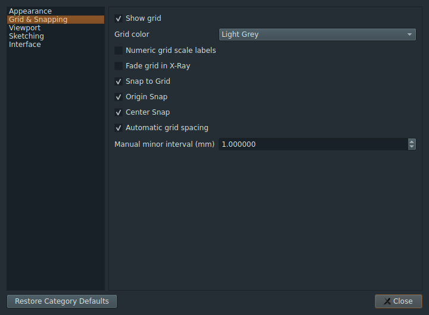
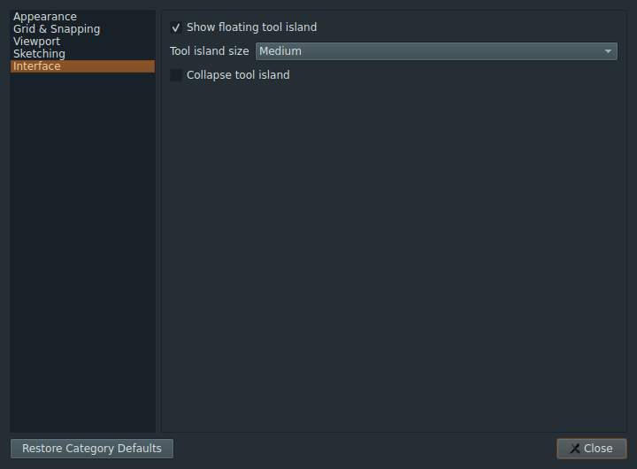

# Centralized preferences — PR #27

Open **Settings → Preferences…**. The compact, resizable, dark Qt dialog has
Appearance, Grid & Snapping, Viewport, Sketching and Interface categories. Changes
apply immediately. **Close** keeps changes; Escape closes the dialog without
reverting already applied preferences. Tab/Shift-Tab traverse normal Qt controls.

**Restore Category Defaults** resets only the selected category, including island
position for Interface. It needs no global-reset confirmation because the button
explicitly identifies the category scope. It does not clear other categories,
unrelated QSettings keys, documents, feature history or per-document visibility.

Existing quick controls remain available. A toolbar/menu/island change updates
an open dialog; a dialog change updates the toolbar/menu/island and viewport.
Manual grid spacing is editable only with Automatic Grid disabled. There are no
restart-required preferences in this release.

## Audit of existing state

All entries below use the existing `QSettings('HERO-CAD', 'HERO-CAD')` backing
file; no second config location is introduced. New keys extend the existing
versioned namespaces. Previously persisted keys keep their names and values.

| Preference | Before PR #27 | Stable key | Default / allowed values |
|---|---|---|---|
| High-contrast geometry | Persistent | `viewport/v1/contrast` | Auto; Off / Auto / Always |
| Grid visible | Session | `grid/v1/grid_visible` | On |
| Grid color | Persistent | `grid/v1/color` | Light Grey; existing five presets |
| Numeric grid labels | Persistent | `grid/v1/scale_visible` | Off |
| Fade grid in X-Ray | Persistent | `grid/v1/fade_xray` | Off |
| Grid snap | Session | `grid/v1/snap_grid` | On |
| Origin snap | Session | `grid/v1/snap_origin` | On |
| Center snap | Session | `grid/v1/snap_center` | On |
| Automatic spacing | Session | `grid/v1/automatic` | On |
| Manual minor spacing | Session | `grid/v1/manual_spacing` | 1 mm; 0.000001–100000 mm |
| X-Ray | Session | `viewport/v1/xray` | Off; Off / Celadon / Orange |
| Edge selection radius | Session | `viewport/v1/edge_tolerance` | 6 px; integers 2–10 |
| Display mode | Session | `viewport/v1/display_mode` | Shaded with CAD Edges; existing four modes |
| World origin axes | Session | `viewport/v1/axes_visible` | On |
| Auto-hide consumed sketches | Persistent | `viewport/v1/auto_hide_sketches` | On |
| Dimension popup opacity | Session | `interface/v1/dimension_opacity` | 100%; integers 0–100 |
| Tool island visible | Persistent | `tool_island/v1/visible` | On |
| Tool island size | Persistent | `tool_island/v1/size` | Medium; Compact / Medium / Expanded |
| Tool island collapsed | Persistent | `tool_island/v1/collapsed` | Off |
| Tool island position | Persistent | `tool_island/v1/x`, `y` | Automatic upper-right initially; signed bounded pixel integers, clamped to viewport |

The dimension opacity control affects the construction input popup. Solid
reference opacity is established rendering behavior (35% while editing, 85% for
explicit X-Ray), not a configurable sketch-opacity setting. No nonfunctional
opacity slider is added.

Individual sketch visibility stays **document metadata** in the browser, not an
application preference. Show base box retains its existing session override and
geometry-aware default. Selection/filter state, active tool, camera, Previous
View and navigation gestures are interaction state, not persisted preferences.
No navigation binding editor or new display behavior is introduced.

## Implementation

`preferences.py` contains a finite typed catalogue: stable keys, categories,
labels, defaults, choices/ranges and exposed controls. `Preferences` reads the
same QSettings object, validates saved types/ranges, falls back on invalid or
missing values, writes explicit changes, and emits a change signal once per
changed value. It accepts Qt's persisted true/false and numeric strings on read;
runtime writes require valid typed values. Unknown/unrelated settings are left
alone. There are no new document fields or geometry dependencies.

`ui/preference_bindings.py` connects those values to existing Qt actions/widgets
and their existing behavior paths. Direct X-Ray/display mode changes and island
layout changes publish back to the same store. The dialog only reads/writes this
store; it does not copy preference state or implement viewport behavior. A small
reentry guard handles synchronous Qt signals. The island retains its layout,
position clamping, command actions and mouse handling; its persistence now uses
the shared validation/notification path.

## Desktop review

1. Set a few existing preferences before updating; launch the new version and
   verify grid colors/labels/fade, contrast and island layout survive.
2. Open each Settings category; change every exposed value and check its existing
   quick control and immediate effect. Change toolbar/menu/island controls with
   the dialog open and confirm it updates. Close/reopen Settings to verify values.
3. Turn off Auto Grid and enter a manual minor interval. Check the toolbar,
   exact grid/snap spacing, numeric labels and all three origin planes. Repeat
   while editing a face-attached sketch. Enable Auto Grid again.
4. Verify X-Ray and contrast in Top/Front/Side, isometric and sketch edit modes.
   Confirm 1-pixel CAD/sketch lines, snapping, selection and navigation are intact.
5. Change edge hitbox, popup opacity (including Off) and island size/visibility/
   collapse/position. Restart HERO-CAD; verify all persisted values are restored.
6. Restore a category's defaults. Confirm other categories, current sketch,
   current document dirty/history state and per-sketch visibility are unchanged.
7. Create/edit sketches, extrude, perform a Boolean, Undo/Redo, save/reopen an
   existing `.starcad` file. Preferences must not change the model or document.

No new UI framework, theme editor, geometry feature or settings-storage system.
