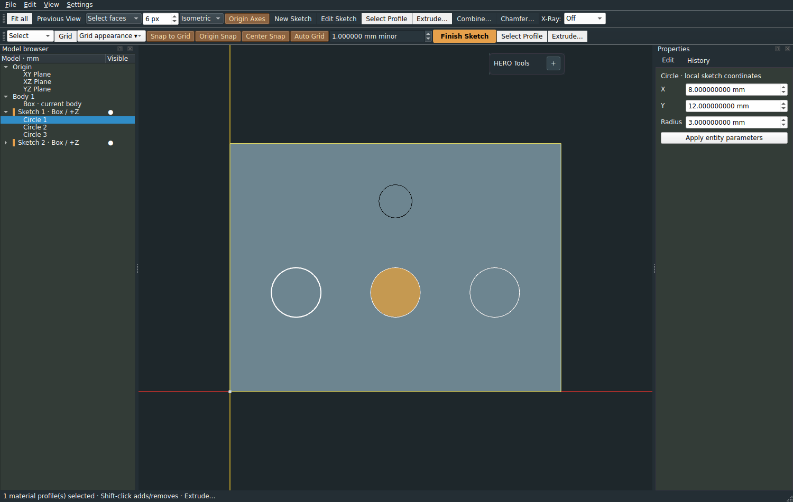
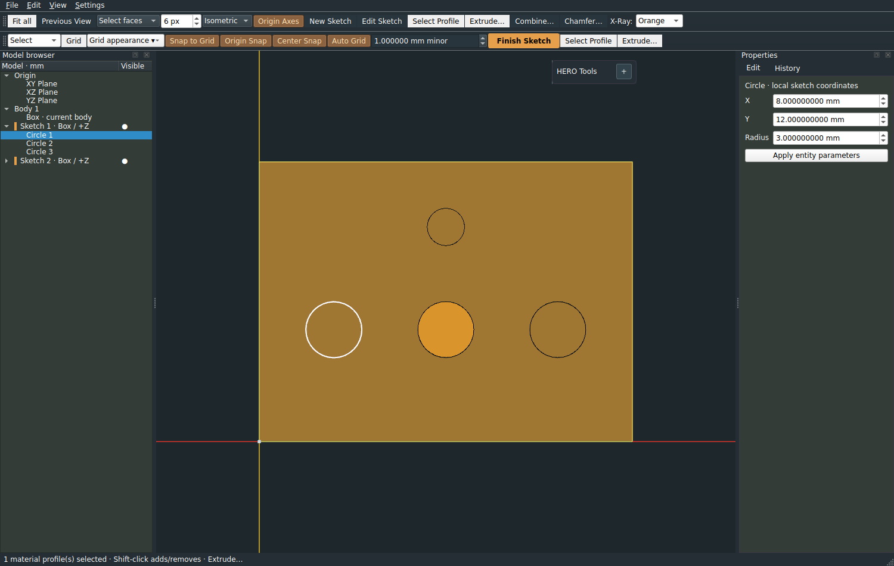
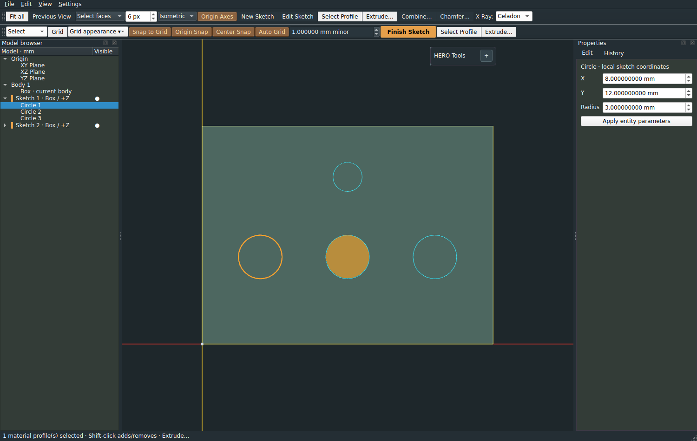
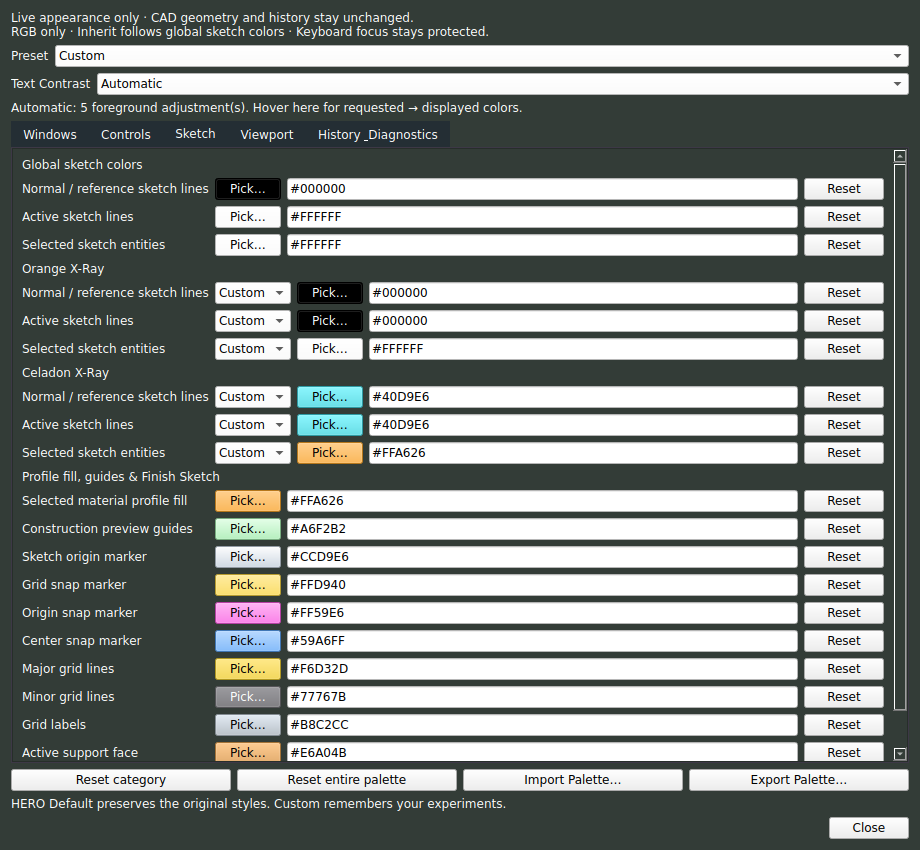

# Work Order 045 — appearance refinement

## Inspection before changes

PR44 has 55 RGB roles, optional overrides in Preferences, and one modeless editor/
controller. Sketch normal/reference, active foreground and selected-entity actors
have independent global colors; mode changes currently recolor solids, not these
sketch actors. Profile fill is a fourth independent actor and must stay separate.
The existing header toolbar owns a Finish Sketch QAction; widgetForAction can
style its QToolButton without replacing the action or completion callback.

Text inconsistencies have several concrete code paths to verify: readable() silently
substitutes black/white below 4.5:1; later QDialog QWidget rules can beat general
text/inherited styles; operation-local QLabel/input/button rules override parent
styles; focused/checked operation controls have more specific legacy selectors
than the lab's normal-button overrides. General text is not intended to override
separate input/button/operation roles. Current UI does not explain those scopes
or display contrast substitutions. These are appearance rules, not native geometry
or persisted color-value loss.

Keep the existing role registry/controller and renderer. Add six optional sketch
mode colors with global fallback, one default-orange Finish highlight, and an
Automatic/Manual foreground policy. Keep focus protection independent. Preserve the
55 original mandatory v1 color keys and override metadata; accept new optional
properties/metadata while rejecting unknown or malformed records. Existing files
must import without editing. User fixture retains its complete original override
list; it is a regression reference, not a new default palette.

## Investigation results

The supplied reference export stores `ui.text = #000000` on `ui.background =
#242E34`. Original Automatic contrast displays white while retaining black in
storage: this is intentional substitution, previously silent. Native/contextual
fallbacks are also intentional: a color listed in an export is not an explicit
override unless named in its `overrides` metadata.

A separate, unintended issue is pseudo-state precedence in operation windows:
with an explicit `controls.text = #12DDAA`, a focused Apply button's reported
QPalette foreground was green, but the grabbed widget actually painted legacy
`#241C16` glyphs on `#D9B590`. Thus inspecting palette() alone missed the problem.
The existing operation stylesheet's focus rule beat the palette's normal-state
rule during painting. The new focused/hovered/active/disabled rules match the
existing scopes and states; Manual-mode regression checks actual glyph pixels.
Scoped Properties/dialog secondary and heading rules now use their own backgrounds
rather than unrelated inherited/general foregrounds. No Qt styling framework was
replaced.

## Sketch inheritance and live behavior

The Sketch tab groups Global, Orange X-Ray, Celadon X-Ray, then profile fill/guides/
Finish Sketch. The six optional keys are:

| Role | Orange | Celadon |
|---|---|---|
| Normal/reference curves | sketch.orange.normal | sketch.celadon.normal |
| Active foreground curves | sketch.orange.active | sketch.celadon.active |
| Selected sketch entities | sketch.orange.selected | sketch.celadon.selected |

Normal view uses the original `sketch.normal`, `sketch.active`, `sketch.selected`.
Each mode row has Inherit/Custom; Inherit removes its explicit stored override and
shows the effective global RGB in the disabled hex field and swatch. Choose Custom
to edit it. Changes to a global propagate into inherited modes; explicit mode
colors remain fixed. HERO Default ignores stored experiments; Custom restores them.
No mode-specific override is enabled by default. `sketch.profile` remains independent
of selected curves and mode-specific colors.

The existing three sketch actors are recolored through the existing viewport style
callback using the active mode, so entry/exit, selection and frame refresh cannot
overwrite the chosen role. Mode switches recolor guides without rebuilding their
meshes; existing fade and label opacity still update. Sketch/general X-Ray opacity,
lighting, camera, source frames, geometry and history remain independent.

## Text Contrast and role scopes

The editor always displays **Text Contrast: Automatic / Manual**.

- Automatic is the default, including when reading old files. It keeps readable
  black/white substitution where needed. The status line reports the number of
  adjusted foreground rules; its tooltip lists requested → displayed RGB and the
  relevant background. This describes possible styled states, not a count of
  currently visible widgets.
- Manual uses the selected RGB foreground exactly in supported palette-controlled
  widgets, including focused operation buttons. Low contrast is allowed deliberately.
  Focus borders remain protected. Swatch labels and Finish Sketch text are derived
  for legibility, rather than representing a separately requested text role.

| Text property | Supported scope |
|---|---|
| ui.text | General interface/form labels; separate control/operation roles take precedence |
| ui.secondary | Tool-island hints and Properties info labels tagged as secondary |
| ui.heading | Dock/header/tab text, tool-island title and palette section headings |
| controls.text | Normal, hovered and focused unpressed buttons |
| controls.active_text | Pressed/checked buttons |
| controls.disabled_text | Disabled buttons and input controls |
| controls.input_text | Enabled input text, including focused fields |
| operation.text | Operation and numeric-popup labels; diagnostics keep their own role |

Native OS decorations and arbitrary untagged third-party widgets are outside this
bounded editor. Native input selection colors remain distinct from input text;
browser selection uses its existing separate text role. Manual is not a generic
stylesheet scripting mode. Changing it does not alter any stored RGB values.

## Finish Sketch

`sketch.finish` (Sketch → Finish Sketch Highlight) defaults to existing HERO orange
`#E6A04B`. The existing header toolbar's QToolButton is obtained with
widgetForAction and styled by object name. Its original QAction/callback is kept.
While enabled in sketch editing it has orange/custom fill, derived contrasting
text, a distinct hover fill and a contrasting two-pixel keyboard-focus border.
The existing toolbar hides and action disables at Finish; no disabled highlight
or new completion logic is introduced. This deliberately changes only the header
Finish action's default emphasis, not the tool-island layout or membership.

## JSON compatibility and persistence

The format stays `hero-ui-palette`, version 1, with additive optional fields. The
55 original roles are still mandatory; missing old roles, unknown properties,
malformed RGB, duplicate keys/override names and invalid contrast modes reject
atomically. The six context roles and `sketch.finish` are optional on import.
Missing context roles inherit globals; missing Finish uses its orange default.
The optional root `text_contrast` is Automatic when absent, or Automatic/Manual.
Exports include all 62 effective RGB values, explicit `overrides`, and this mode.
Only the override list establishes explicit colors; inherited effective values in
`colors` are informational, preserving the original fallback semantics.

The complete supplied 55-color, 2534-byte export is retained as
`tests/fixtures/palettes/hero-palette-user-v1.json`, including its original override
list. Tests compare every explicit value/override, clear stale new properties on
legacy import, and round-trip the new metadata. It is not installed as a default.
New exports require a reader that understands the optional PR45 fields; older
PR44 builds reject those new properties rather than silently reinterpreting them.
No manually edited legacy file is necessary.

All colors/inheritance and text contrast use existing Preferences/QSettings keys
under palette/v1; None means no explicit color. Opacity and unrelated preferences
are unchanged. Individual/category reset affects only its colors; whole-palette
reset also restores Automatic contrast. No appearance data enters .hcad files.

## Screenshots, evidence and limits

Examples are configured only in the reproducible harness, not application defaults.
The left large circle is selected geometry, the filled middle circle is an
independent material profile, the right circle is active unselected geometry, and
the small upper circle is an inactive reference sketch.

`tools/preview_sketch_045.py` generates the real Qt/VTK captures in temporary
settings and measures mode switches and color updates with the editor open,
including event processing/redraw. The raw report is
[docs/benchmarks/sketch-045.json](benchmarks/sketch-045.json). It checks unchanged
feature/history/serialization/mesh/selection identities and records zero geometry
evaluations and solid-display preparations. No hardware performance thresholds.
Native/software-render screenshots and tests cannot establish NVIDIA/high-DPI
appearance on the user's machine. Custom low-contrast Manual choices can be hard
to read by design; choose Automatic to restore foreground protection.

18 new regression cases cover global inheritance, both requested mode examples,
repeat transitions with entity/profile selection, face-attached editing, deselect/
reselect, Finish/reenter and both opacity settings, actual focused-button glyphs,
role-specific labels/inputs/headings, Finish QAction/hover/focus/emphasis, startup
persistence, exact legacy metadata and strict atomic import failures, plus active
operation-preview preservation. Existing regression tests remain unchanged.
