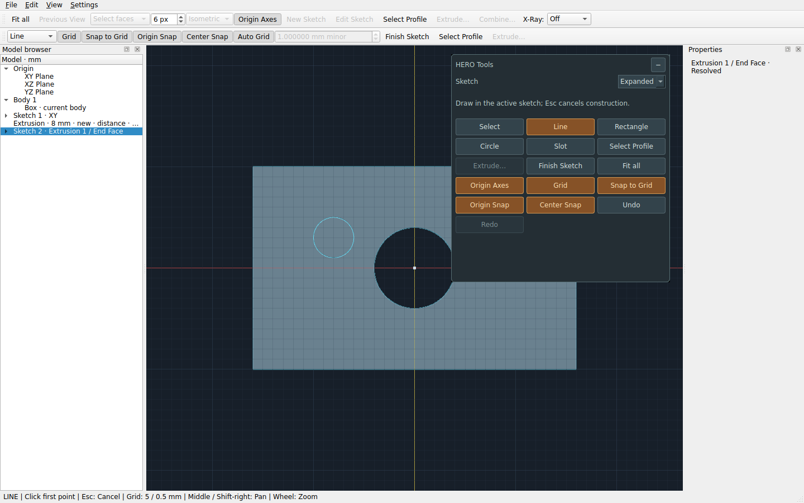
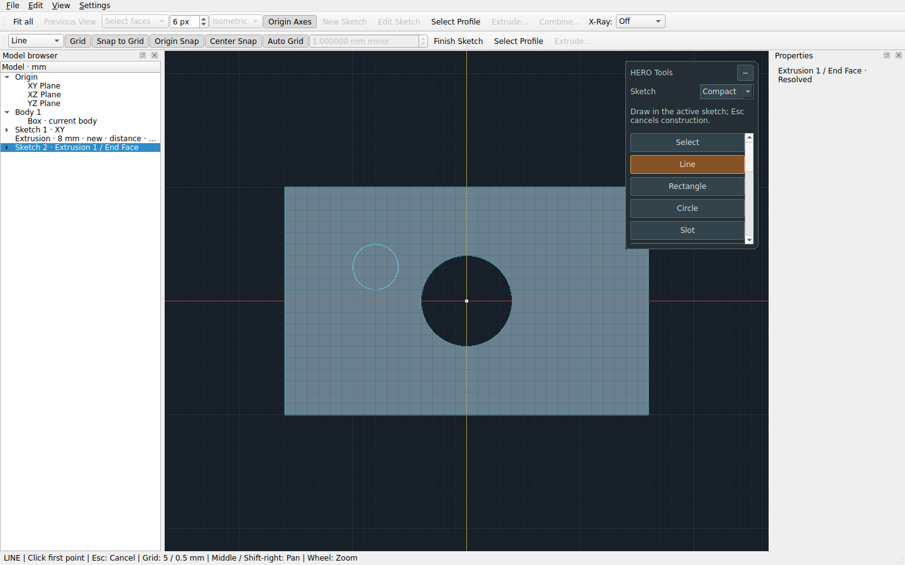
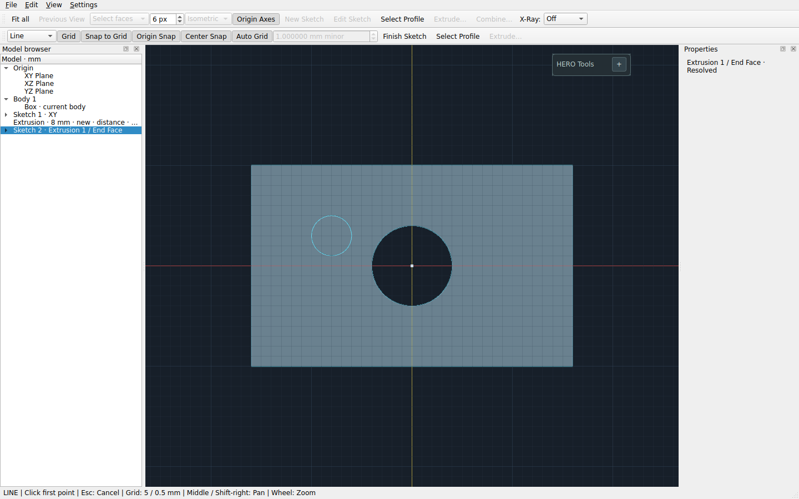

# Floating tool island — PR #21

The island is another view of existing application commands. It creates no
new modeling operations and keeps the existing toolbars, menus and shortcuts.

## Layout and preferences

- Drag **HERO Tools** by its header to reposition it within the viewport.
- Choose **Compact**, **Medium** or **Expanded** for one, two or three command
  columns. Smaller sizes scroll vertically when needed.
- Click **−** to collapse to the header; click **+** to restore the chosen size.
  Changing sketch/selection context never automatically expands it.
- **View → Floating Tool Island** hides/shows it, including after a restart.
- Layout settings save immediately after explicit changes (dragging saves on
  release) and again on successful window close. They are not geometry,
  `.starcad` contents, dirty state or document Undo history.

The default is visible, expanded, Medium, near the viewport's upper-right.
Position is stored as viewport-local pixels. Window/dock/toolbar changes can
clamp the effective position and size to keep it accessible; its preferred
placement/preset remain available when space returns. Expansion near an edge
can also clamp the larger footprint. The viewport has a small 224 × 180 logical
pixel minimum so the header and one command column remain usable.

On Linux the ordinary Qt settings file is
`~/.config/HERO-CAD/HERO-CAD.conf`, under `tool_island/v1`. Other platforms use
Qt's normal settings location. Invalid size/position values fall back or clamp.
Preferences remain after New/Open and Undo/Redo, independently of the model.

## Context and shared commands

In model view the island exposes New/Edit Sketch, Select Profile, Extrude,
Combine and existing view/history controls. Select an origin plane in the
browser or a supported planar face to enable New Sketch. A current planar face
takes priority; explicitly choosing an origin plane clears old solid selections.
Selected edges do not introduce Fillet/Chamfer placeholders.

Sketch context shows Select, Line, Rectangle, Circle, Slot, Finish Sketch and
existing profile/grid/snap/history commands. Slot explicitly enters the existing
CircleTool radius → release → second-center stages. Shift+Circle still works,
and the existing numeric Radius/Diameter and center-distance entry remain.
Selecting geometry does not activate a different construction tool.

Buttons use the same QAction objects as the existing toolbar/menu paths.
Enabled/check state and shortcuts therefore have one source of truth. Disabled
tooltips explain the unavailable state. Extrude and Combine open the existing
preview panel; Apply remains the point where a modeling operation commits.
X-Ray, selection, camera alignment and document behavior are unchanged.

The catalogue is intentionally small and static at window creation. Existing
parameterized curve-context actions still pass their explicit picked references
to the existing operation; not every legacy property/file action is registered.
There is no plugin system, customizable scripting or editable command palette.

## Screenshots

Captured from the running Qt/VTK application with a face-attached sketch.

Expanded:

Compact (scrollable):

Collapsed:

## Laptop acceptance checks

1. Launch `hero-cad` from the updated Python 3.12 editable installation. Confirm
   the island starts within the viewport and does not cover the browser/docks.
2. Drag its header to several positions and beyond each viewport edge. It should
   move smoothly, stop within bounds and leave camera/model state unchanged.
3. Try each size. Labels/buttons must remain readable; Compact should scroll
   through all commands. Resize/maximize the application and change dock widths;
   the header/controls must remain reachable. Check a small window as well.
4. Collapse, enter/reenter/finish sketches, select and clear faces/edges. It must
   stay collapsed and retain its requested size/placement where space permits.
5. Hide with View → Floating Tool Island, then show it again. Close/relaunch and
   confirm the chosen visibility, collapse, size and placement return. Repeat
   after New/Open, without changing saved model contents.
6. Select XY/XZ/YZ in the browser, then start a sketch through the island. Repeat
   from a supported solid face. Each activation must create exactly one sketch.
   Curved/unresolved faces should leave New Sketch disabled with a reason.
7. Switch tools using the toolbar and island alternately; active state must
   agree. Draw a Line, Rectangle, Circle and explicit Slot. Check Shift+Circle,
   Shift rectangles, numeric Radius/Diameter entry and grid/center/origin snaps.
8. Finish through the island, choose Select Profile, and use Extrude. Preview,
   Cancel and Apply must behave as before. Select multiple current bodies and
   use Combine. A single Apply must produce one feature/history step.
9. Check Ctrl+Z/Ctrl+Shift+Z, Ctrl+S and F while the viewport is focused. They
   must use the existing actions once, without duplicate operations.
10. Mouse over the panel should control it; wheel over its content should scroll
    it. Outside the visible panel, verify orbit, Shift-right pan, wheel zoom,
    face/edge/sketch selection and Shift-right-double-click alignment. Move or
    collapse the island when it covers a desired model location.
11. Recheck PR #20's line-built dovetail Cut, both X-Ray colors, operation previews,
    Undo/Redo and save/reopen. Panel layout must not affect any geometry.

These are physical desktop instructions. Automated results and environmental
limits are recorded separately in VALIDATION.md.
