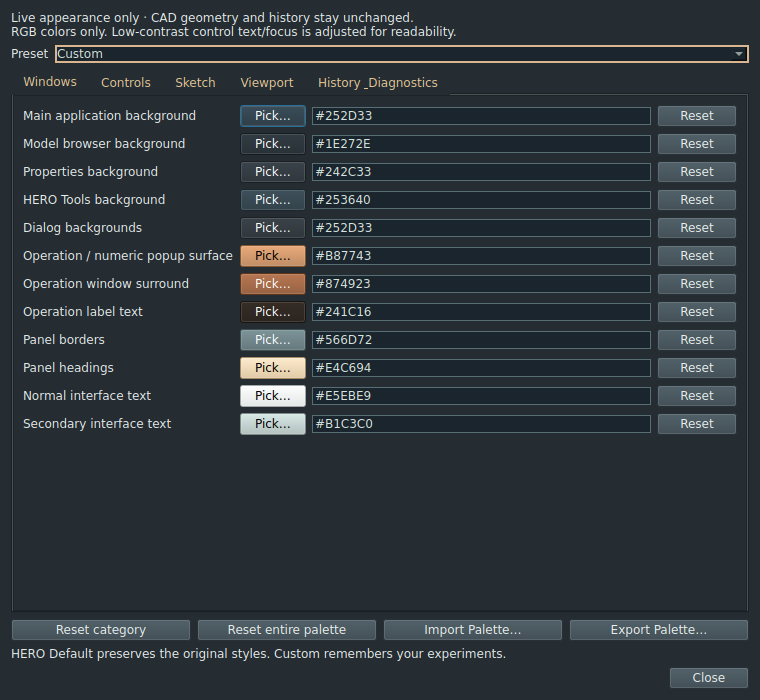
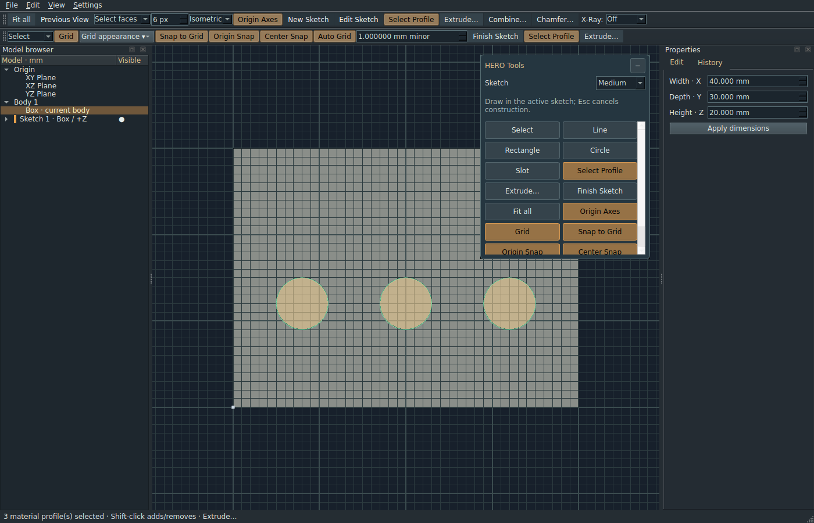

# Experimental UI Palette Laboratory — Work Order 044

PR45 extends this 55-role baseline to 62 roles with optional sketch contexts,
Automatic/Manual text contrast and Finish Sketch emphasis. See the [current
refinement guide](SKETCH_APPEARANCE_045.md); the historical PR44 format and timing
details below remain useful for legacy files.

Open **Settings → Experimental → UI Palette**. The modeless editor stays open
while modeling. Five tabs expose 55 global RGB properties through a swatch/native
color picker, #RRGGBB field and individual Reset. Complete hex values preview
immediately; unfinished values never reach Preferences. The native picker's Cancel
restores the opening value and preset. Closing the editor keeps accepted changes.





These are actual Qt/VTK screenshots from tools/preview_palette_044.py under
Xvfb/software OpenGL, not design mockups. They illustrate an experiment, not new
permanent defaults. The same script records live recolor measurements.

## Available colors

| Tab | Controls |
|---|---|
| Windows | Main background, browser, Properties, HERO Tools, dialogs, operation/numeric-popup surface, operation surround/labels, borders, headings, normal and secondary text |
| Controls | Normal/active/hovered/disabled buttons, button/active/disabled text, browser selection/text, input background/text/border, focus ring |
| Sketch | Finished/reference lines, active sketch lines, entity selection, profile fill, construction preview, local origin, grid/origin/center snap markers, major/minor grid, labels, active support face |
| Viewport | Model base color, regular/high-contrast edges, face/edge selection, viewport background, Orange and Celadon X-Ray base/highlight colors, operation preview |
| History & Diagnostics | Valid/unresolved/blocked indicators, operation error/warning text, History-tab text selection |

Sketch line colors and solid shading are independent. To make every sketch green,
set both Normal sketch entities (finished/reference curves) and Active sketch
entities (the existing foreground edit pass). Model edges have independent regular
and high-contrast colors: Auto contrast intentionally uses the latter in sketch or
face-normal views. Mixed face/edge batches share the existing highlight actor and
use the face-selection color; edge-only selection uses the edge color. Explicit
X-Ray selection colors take precedence while that mode is active.

All controls are RGB only. Existing sketch/X-Ray opacity preferences remain the
sole opacity controls; surface lighting, material coefficients, shadows, depth,
line widths, guide offsets and algorithms are unchanged. World-axis colors and
native window-manager title bars/system decorations are not recolored. Native
message-box status icons remain native; custom history badges supplement existing
operation strips/icons and VALID/UNRESOLVED/BLOCKED text and explanations. Critical
states never rely only on color. Dialog/operation text remains readable. When a
requested control foreground/focus color has insufficient contrast against its
background, display chooses black or white with at least 4.5:1 contrast. The
requested RGB value remains editable/exportable; the same adjustment reproduces
on import. This is a color laboratory, not a complete Qt theme replacement.

## Presets, persistence and reset

**HERO Default** removes all experimental overrides from presentation, restoring
the exact pre-existing native styles and floating-panel styles, including original
VTK floating-point colors. **Custom** retains the saved experimental values while
switching back and forth. Selecting a new color activates Custom. Reset individual,
category or all removes only those color overrides, never document state or other
preferences. An empty Custom palette has the original appearance.

Application Preferences/QSettings stores optional colors under
`palette/v1/<property>` and `palette/v1/enabled`, separate from .hcad documents.
Startup rejects malformed stored colors to their original fallback. The existing
Preferences dialog/categories and legacy grid/X-Ray settings remain available.
Experimental grid colors override the corresponding legacy grid-choice colors
until reset; fade, visibility and snapping still operate normally. A custom main
background is inherited by ordinary dialogs unless their independent background
is explicitly overridden. The editor reflects that effective inherited value.

Defaults for native Qt controls follow the active platform palette. Several
existing components intentionally have different default colors for a shared
property (native buttons versus HERO Tools versus orange operation controls).
Unset overrides preserve those contextual defaults. An explicit global control
color applies consistently to existing and subsequently created controls.

The Open and Save As document choosers use the same Qt widget style. They
follow the dialog background, general text, input and button colors, and
keyboard focus settings. The existing selection color and text settings
also apply to filename selection and file lists. Automatic contrast adjusts
foregrounds for readability, while Manual uses the requested text colors.
Window decorations and system file icons come from the desktop theme.

## Portable JSON and validation

Export Palette writes UTF-8 JSON using QSaveFile (atomic replacement). Import
Palette validates a complete bounded snapshot before a single preference batch
publication. Unsupported versions, unknown/missing properties, duplicate JSON keys,
invalid hex/alpha values, duplicate/unknown override names and malformed JSON are
rejected with feedback; failed imports leave the complete palette unchanged.
All 55 properties must be present; partial palette imports are deliberately refused.

The stable names describe appearance roles rather than widget IDs. A shortened
illustration (not an importable complete file) is:

```json
{
  "format": "hero-ui-palette",
  "version": 1,
  "colors": {
    "viewport.background": "#17202B",
    "viewport.model": "#A6C9DB",
    "sketch.normal": "#71D4A2",
    "sketch.active": "#71D4A2",
    "properties.background": "#242424"
  },
  "overrides": ["viewport.background", "sketch.normal", "sketch.active", "properties.background"]
}
```

Exports include every color's effective/representative RGB value plus an
`overrides` list. The latter preserves native/contextual fallback behavior during
round-trip instead of flattening all component defaults into one widget theme.
A complete external v1 file may omit `overrides`, meaning every supplied color is
an explicit override. Import activates Custom and replaces the complete saved
custom color set. Exporting HERO Default exports the visible defaults, not hidden
Custom experiments; choose Custom first to export those. Explicit chosen colors
are portable; untouched native defaults can still follow the receiving platform.
The registry and export remain usable after the modeless editor is removed.

## Architecture and isolation

palette.py owns a small role catalogue and JSON validation; Preferences adds hidden
optional color entries and validated batch publication. palette_editor.py owns only
controls. palette_controller.py applies scoped styles and SetColor/SetBackground to
existing widgets/actors. Existing operation/island styles are retained and restored;
no new theme framework, renderer, document schema or per-body assignment exists.

The existing viewport style callback consults color overrides, so render/X-Ray
transitions cannot overwrite them. Guide color precomposition is separated from
mesh generation. Appearance changes never call window.refresh, Document mutation,
regeneration or solid display preparation. They keep preview candidates, cached
preview surfaces, actor lighting, geometry IDs, model meshes, selected profile
regions, construction tools, saved/dirty state and Undo/Redo stacks intact.
History icons are repainted on the same browser items; the history tree is not
rebuilt. Styles are installed only when their text changes, and current/future
controls share the same bounded selectors.

## Regression coverage and measured cost

21 new cases cover the work order A–J matrix: original defaults and reset, actual
hex-field updates, live panels/controls, active sketch/profile and grid buffer
preservation, shaded/X-Ray framebuffer visibility, unchanged lighting/opacity,
restart in another process/window, round-trip inheritance, malformed/duplicate/
incomplete import rejection without partial publication, corrupt stored values,
color-picker accept/cancel, diagnostics and browser-item preservation, readable
modeless dialog text and input fields, active multi-profile Cut preview reuse/
Apply/edit/cancel, and New Body/Join/Cut with custom colors. Spies reject any
geometry evaluation, window refresh or solid display preparation during recolor.
All original tests remain unchanged. Full results are in VALIDATION.md.

The reproducible harness measures ten live changes per property, including the
existing software OpenGL redraw and UI styling work in the modeling window,
before opening the editor for its screenshot. Picker/editor event overhead is not
included in those controller timings. It records zero geometry
evaluations and zero solid-display preparations, and checks definitions/history/
serialization/meshes/profile selection identity. Results and environment are in
[the raw report](benchmarks/palette-044.json). There are no hardware timing gates.
No debounce is introduced; updates are synchronous and bounded. Software-render
measurements are not desktop GPU performance guarantees.

Future refinements: use exported experiments to choose permanent defaults, then
simplify/remove the editor; assess larger real parts before adding any throttling;
consider separate mixed-selection highlight actors only as a dedicated later task.
Per-body colors, materials, new modeling tools and layout changes remain out of scope.


## Opacity follow-up and separate font report

See [the PR 44 opacity correction](XRAY_OPACITY_044.md) for independent Sketch and
General X-Ray opacity, numeric-entry repair and persistence. The RGB registry and
palette JSON format are unchanged. The user's separate report of font-color
controls being overridden is recorded for later investigation; it is intentionally
not included in this opacity patch.
