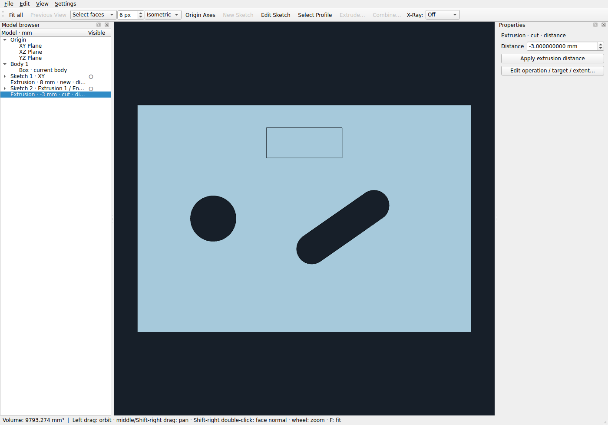
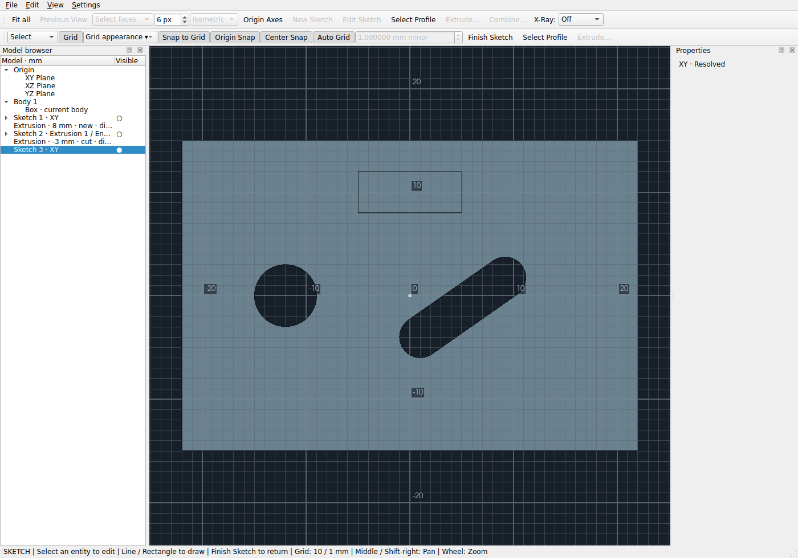

# Viewport clarity and sketch display — PR #26

## Controls

- **Settings → High-Contrast Geometry → Off / Auto / Always**, default **Auto**.
  Auto strengthens genuine CAD boundary edges during sketch editing and in
  orthographic views within two degrees of a principal axis or an evaluated
  analytic planar-face normal. Isometric views otherwise return to the original
  edge style. Always retains the stronger style; Off retains the previous style.
- **Settings → Auto-Hide Consumed Sketches**, default **On**. A successful new
  extrusion hides its entire source sketch, including other regions in that
  sketch. New Body, Join, Cut and Intersect share this commit path. Editing an
  existing operation does not hide a sketch the user subsequently revealed.
- The browser's **Visible** column shows **●** for shown and **○** for hidden
  sketches. Click the indicator to toggle immediately without changing the
  current item, multi-selection, camera, construction tool or solid selection.
  Tooltips describe the action. These are display controls, not suppression.
- Editing a hidden sketch temporarily reveals it. Finish restores its stored
  state. Explicit visibility changes made during editing are retained. Browser
  **Select Profile** also temporarily reveals its explicitly scoped sketch for
  inspection, without changing its stored state.

Both Settings preferences persist in application settings. Grid color, scale
labels, grid visibility, snapping, X-Ray fade, X-Ray modes and dimension-popup
opacity retain their existing controls.

These captures combine the actual Qt widget capture with its actual VTK color
buffer, because QWidget.grab alone cannot capture the native OpenGL surface.

## Grid investigation and correction

The original lattice already used exact 1–2–5 adaptive major intervals, ten
minor subdivisions, bounded density and mutually exclusive major/minor line
classification. There were no duplicated coincident major/minor levels to remove.
The artifact also reproduces with all solid bodies and axes hidden, excluding
solid/grid z-fighting as the cause of the isolated lattice artifact.

The grid used two translucent world-line actors, each including horizontal and
vertical lines. Their fragments alpha-blended repeatedly at intersections. A
regression test restores that original presentation and measures brighter minor
crossings than uninterrupted minor lines; corrected crossings match the lines.
This regular two-dimensional intensity modulation produces a textured lattice.
When changing to opaque lines, another reproducible issue must also be addressed:
MSAA distributes a one-pixel line across samples according to its fractional
screen position. At a 19.37 mm parallel scale, naive opaque minor lines differed
by 19 mean RGB intensity levels on the tested Mesa renderer.

The correction stays in the two existing grid actors:

1. Precompose each guide's existing color/strength against the viewport background
   and draw opaque, depth-tested guide fragments. Crossings cannot accumulate
   alpha; major lines have a slightly nearer guide-only depth bias than minors.
   The selected preset and existing dense-grid/X-Ray fade strengths remain.
2. A small grid-only vertex-shader adjustment aligns raster positions for exactly
   face-normal, horizontal/vertical screen lines: minor centers at half pixels,
   major centers at whole pixels. The two widths are **1 / 2 physical pixels**.
   The maximum raster displacement is half a pixel. World mesh coordinates,
   sketch frames, labels, model geometry and snap calculations remain unchanged.
3. Tilted, rolled and perspective views retain ordinary world-line rendering and
   antialiasing. There is no renderer replacement, global depth change, global
   brightness increase or camera-dependent document edit.

Major spacing remains the existing 1–2–5 progression; manual spacing still sets
minor mm with majors ten times that interval. The renderer's bounded subset for
extremely dense manual grids does not change snapping. Labels now contain just
signed numbers, keeping exact local coordinate values and existing overlap/cull
limits, including face-attached frames. Units remain in the browser/status UI.

Pixel tests cover XY/XZ/YZ, 714×677 and 883×521 viewports, parallel scales 19.37,
22.123 and 35.71, and slightly tilted/isometric views. At face normal, sampled
minor brightness differs by at most two intensity levels and measured widths are
one/two pixels. Existing exact-spacing and snapping regressions remain enabled.
These are bounded image measurements, not a claim of identical rasterization
across drivers. The original laptop screenshots were not attached to this spec;
its exact larger-scale pattern and Nvidia rendering still need desktop review.

## Solid edges and depth

The contrast setting styles only the existing true B-rep edge actor: neutral
charcoal, one pixel, opaque when enhanced. It uses the same geometry, modest
existing line offset and original depth buffer. Hidden edges behind opaque bodies
remain hidden; a rendered regression places an entire cylinder behind an opaque
box and checks that no interior cylinder boundary leaks. X-Ray modes keep their
existing translucent-body behavior rather than gaining a hidden-edge overlay.

Orange selection highlights retain their existing actor/color/width (including
Orange X-Ray's brighter warm selection). Active sketches remain cyan in the
foreground editing pass; inactive shown sketches use a quieter blue-cyan. Grid
actors and sketch actors are excluded from solid-edge recoloring. Camera changes
only check cached analytic normals and update properties, without remeshing.

## Visibility, transactions and compatibility

`Feature.sketch_visible` is presentation metadata, default True, outside geometric
parameters. It is never used by regeneration, dependency resolution, profile
construction or face-reference resolution. Visibility-only commits reuse the
existing evaluated bodies and face maps without regenerating the kernel. They
use the existing document Undo/Redo stack and dirty/save behavior.

Automatic hiding is included in the same validated document transaction as a
new extrusion. Preview, invalid values, failed Booleans and Cancel never change
it. Undo/Redo restores visibility together with the extrusion. Manual toggles
also use ordinary document history. No separate visibility-history system exists.

`.starcad` v11 adds an optional boolean `sketch_visible` field on sketch feature
records. It is written only for hidden sketches; all-shown documents retain the
schema version their geometry requires. Existing v1–v10 files default to shown
and are not automatically hidden merely because they contain an extrusion.
Non-boolean metadata, visibility on solid features and v11 metadata in older
schemas are rejected. Old application versions cannot open v11 files; update the
application before sharing files with hidden-sketch metadata. Atomic saves,
geometry parameters, references and feature ordering are unchanged.

## Desktop checks (Ubuntu 22.04 / Nvidia still required)

1. Open an existing document. Confirm previous geometry regenerates and sketches
   without visibility metadata remain shown. Save/reopen after hiding one sketch.
2. Enter XY, XZ, YZ and a compound-angle face-attached sketch. Hide bodies briefly;
   inspect the grid straight-on, slightly tilted and isometric. Zoom continuously
   through fractional scales and resize the window. Check uniform minor lines,
   two-pixel majors, adaptive 1–2–5 distances, negative numeric-only labels and no
   large brightness bands. Repeat each color and Fade Grid in each X-Ray mode.
3. Re-enable bodies. Check that the grid remains subordinate, not drawn as an
   overlay over opaque surfaces. Confirm exact grid/origin/center snapping and
   numeric construction dimensions are unchanged with grid shown and hidden.
4. Create a plate with circular/slot through-holes and a blind pocket. Compare
   Top/Front/Side, Look At Face and isometric using Off, Auto and Always. Verify
   thin visible boundaries, hidden-edge occlusion and orange selection. Repeat
   while editing and with Celadon/Orange X-Ray.
5. With auto-hide on, extrude using each operation. The source sketch disappears
   only after Apply/Enter succeeds. Undo restores the previous visibility and
   geometry; Redo restores both. Preview/Cancel and an invalid/nonoverlapping Cut
   must leave visibility untouched. Repeat with auto-hide off.
6. Select a different browser item (and multiple items); toggle a sketch's Visible
   indicator. Selection and camera must remain unchanged. Toggle several sketches
   independently. Edit a hidden sketch, draw/select an entity and Finish: it must
   return to hidden. Explicitly show it while editing and Finish: it stays shown.
7. Reopen the saved document and verify visibility, solids, dependencies and face
   attachments. Restart the app and verify both new Settings preferences persist.

No new modeling operation, snapping algorithm, persistent-reference change or
launcher integration is included.
